# 세모지 밈 라이브러리

세모지 영상(브랜드백과 등)에서 쓴 **밈 버전 장면**을 모아 둔다. 새 편을 만들 때 펀치라인·반응 자리에 어떤 밈을 어떻게 그렸는지 찾아 쓰는 용도다.
추가는 `python3 auto_agent/scripts/meme_library_add.py <entries.json>` (프레임 추출 + index.json + 이 표 갱신).

## 두 그림체를 구분한다

| | 브랜드백과 기본체 | 밈 버전 |
|---|---|---|
| 얼굴 | 둥근 얼굴, 분홍 볼터치, 단순한 이목구비 | 실사에 가까운 캐리커처 얼굴, 주름·명암이 있다 |
| 표정 | 잔잔한 미소·놀람 | 과장된 표정(울부짖음, 비웃음, 황당, 분노) |
| 쓰는 자리 | 이야기를 끌고 가는 대부분의 장면 | 한 대목을 끝내는 펀치라인, 반응, 반전, 경쟁 구도의 대결 |
| 글자 | 장면 설명용 배지 | 말풍선·폭발 글자(「제발!!!!」「750달러 Go!」「그만..!」) |
| 기준 프레임 | `artstyle/templates/semoji_brand/refs/` | 이 폴더 `img/` |

- 밈 장면은 **한 대목에 한 번**, 연달아 쓰지 않는다. 기본체 장면 사이에 끼워야 웃음이 산다.
- 실존 인물을 밈 버전으로 그릴 때도 같은 사람은 기본체 시트와 생김새(머리·안경·옷)를 맞춘다.
- 유명 밈·캐릭터 패러디는 원본 짤의 구도와 표정을 따르되, 세모지 평면 벡터 질감(색면 + 종이 결)으로 다시 그린다.

## 밈 종류

- **유명 밈 패러디**: 누구나 아는 짤·캐릭터의 표정과 구도를 빌린다(니콜라스 케이지 「You don't say」, 신데렐라 계모, 냥캣).
- **실사 캐리커처 반응**: 실사풍 얼굴로 감정을 크게 보여 준다(우는 남자, 화난 젠슨, 웃으며 칩을 든 남자).
- **의인화**: 회사·제품을 사람으로 만들어 대결시킨다(왕과 헐크, 권투 선수, 얼굴에 로고).
- **텍스트 폭발**: 폭발 말풍선 글자가 장면의 중심(「750달러 Go!」).

## 새 장면을 그릴 때 (codex $imagegen)

이 폴더의 같은 종류 장면을 1번 이미지로, 등장인물의 기본체 시트를 2번 이미지로 붙인다. 지시는 짧게: "1번 이미지와 같은 밈 버전 그림체(실사풍 캐리커처 얼굴, 평면 색면, 종이 결)로, 2번 이미지의 인물이 ○○하는 장면". 공냥 규격(부정어 없음, 끝에 AR 16:9) 그대로.

## 목록

| 그림 | id | 편·시각 | 종류 | 밈 | 쓰는 자리 | 감정 | 내레이션 |
|---|---|---|---|---|---|---|---|
| 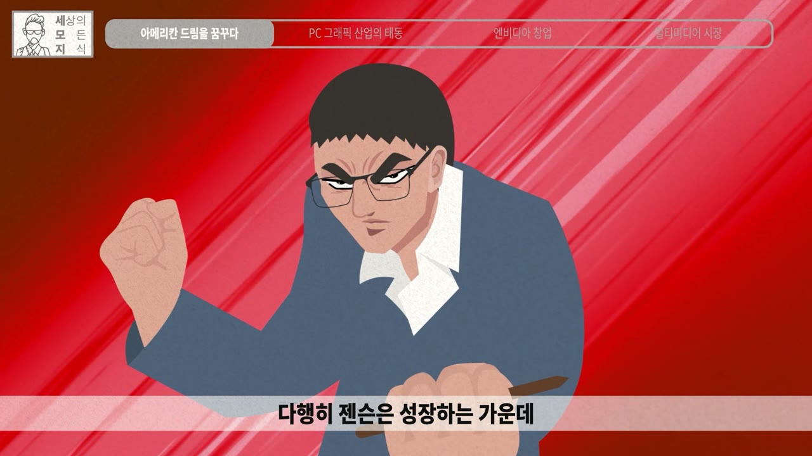 | `nv1_jensen_angry_study` | B145 엔비디아 1편 120초 | 실사 캐리커처 반응 | 결심한 표정(만화 주인공 클로즈업) | 결심·전환점 | 결의 | 자신의 처지를 바꿀 것은 오직 공부뿐이라는 것을 깨닫고 |
| 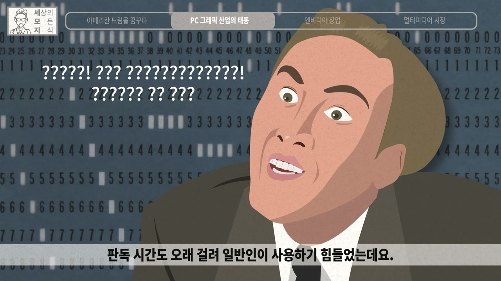 | `nv1_youdontsay` | B145 엔비디아 1편 215초 | 유명 밈 패러디 | 니콜라스 케이지 You don't say(????) | 황당한 옛 기술 설명 | 황당 | 판독 시간도 오래 걸려 일반인이 사용하기 힘들었는데요 |
| 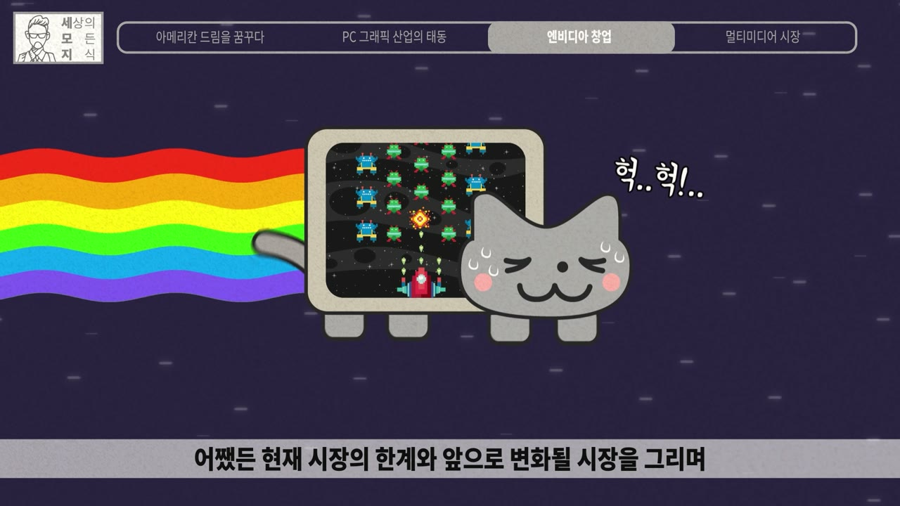 | `nv1_nyancat` | B145 엔비디아 1편 408초 | 유명 밈 패러디 | 냥캣(Nyan Cat), 헉헉 | 힘에 부치는 구형 기술 | 힘듦, 귀여움 | CPU가 실시간으로 그래픽을 구현하는 것이 전부였기 때문이죠 |
| 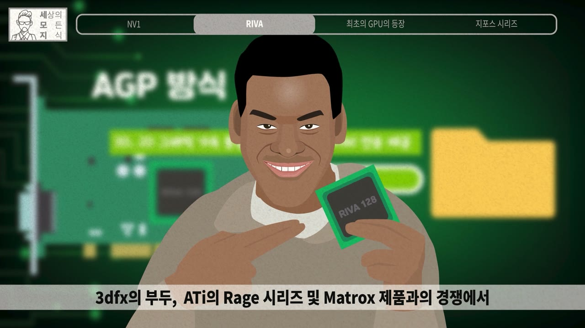 | `nv2_agp_grin` | B146 엔비디아 2편 246초 | 실사 캐리커처 반응 | 자신만만하게 웃으며 칩을 든 남자 | 제품 자랑·자신감 | 자신감 | 3dfx의 부두, ATi의 Rage 시리즈 및 Matrox 제품과의 경쟁에서 |
| 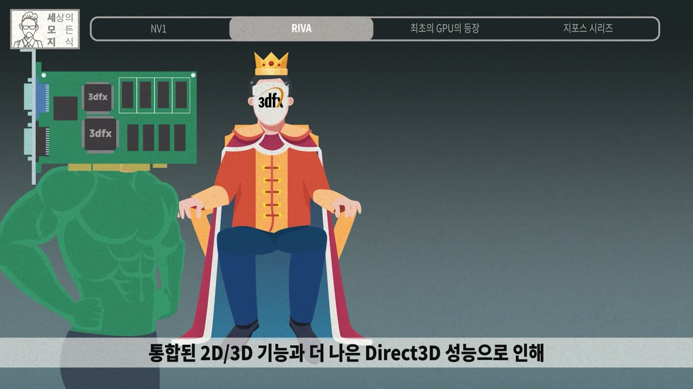 | `nv2_king_hulk_rival` | B146 엔비디아 2편 260초 | 의인화 | 왕좌의 왕(얼굴에 3dfx 로고)과 헐크 | 시장 1위 경쟁사 소개 | 위압 | 게이머들 사이에서 넘버원 그래픽 카드로 꼽혔기 때문에 |
| 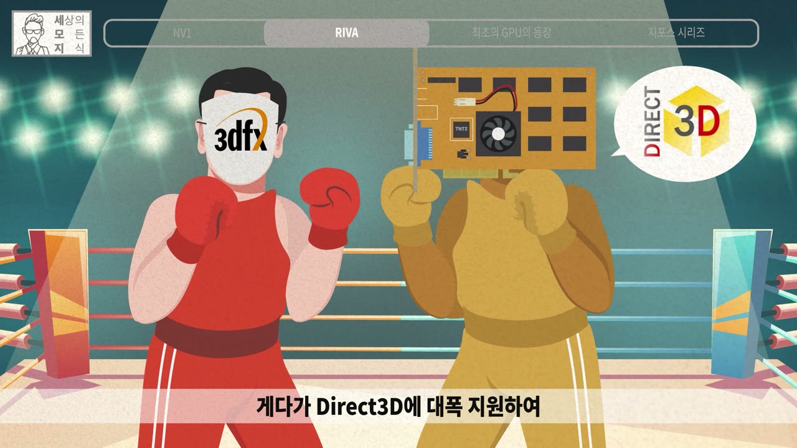 | `nv2_boxing_rival` | B146 엔비디아 2편 320초 | 의인화 | 링 위의 권투 대결(얼굴에 로고·제품) | 경쟁 구도 대결 | 대결 | 게다가 Direct3D에 대폭 지원하여 |
| 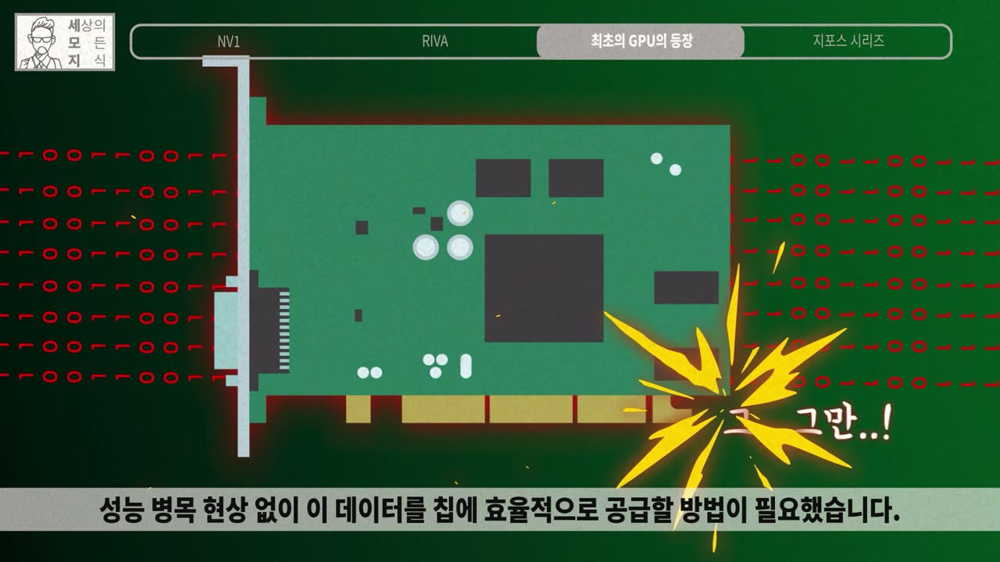 | `nv2_card_stop_overload` | B146 엔비디아 2편 390초 | 의인화 | 과부하에 비명 지르는 그래픽카드(그.. 그만..!) | 기술 한계·과부하 | 고통 | 성능 병목 현상 없이 이 데이터를 칩에 효율적으로 공급할 방법이 필요했습니다 |
| 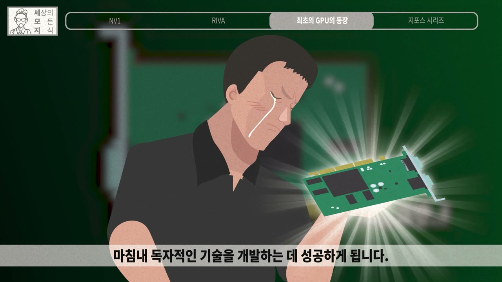 | `nv2_crying_card` | B146 엔비디아 2편 396초 | 실사 캐리커처 반응 | 감격해 울며 그래픽카드를 든 남자 | 돌파·성공의 감격 | 감격 | 마침내 독자적인 기술을 개발하는 데 성공하게 됩니다 |
| 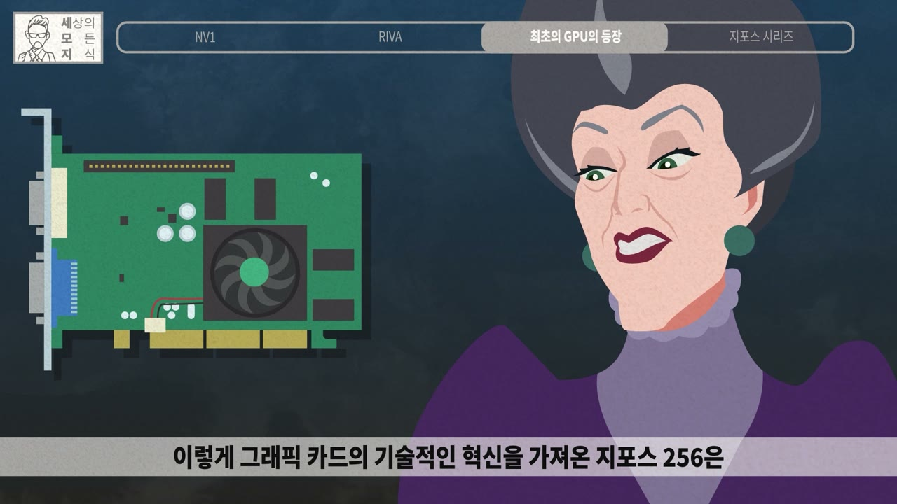 | `nv2_stepmother_sneer` | B146 엔비디아 2편 470초 | 유명 밈 패러디 | 신데렐라 계모의 비웃음(그래봤자 출력 장치일 뿐이지~) | 얕보던 통념을 뒤집기 직전 | 비웃음 | 이렇게 그래픽 카드의 기술적인 혁신을 가져온 지포스 256은 |
| 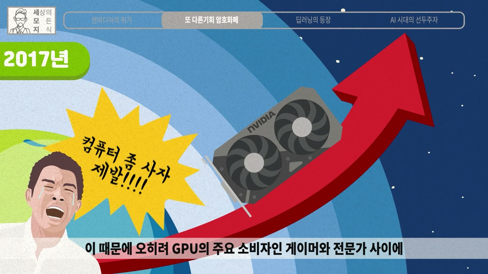 | `nv3_please_buy_crying` | B146 엔비디아 3편 284초 | 실사 캐리커처 반응 | 울부짖는 남자(컴퓨터 좀 사자 제발!!!!) | 품귀·가격 폭등에 고통받는 소비자 | 절규 | 전보다 더해진 수요를 감당 못 한 엔비디아 GPU의 가격이 부풀기 시작했습니다 |
| 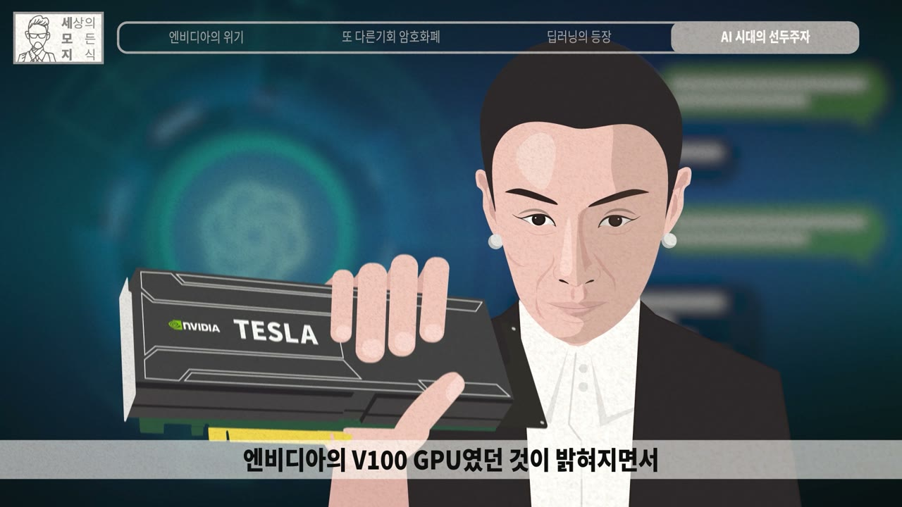 | `nv3_tesla_card_believe` | B146 엔비디아 3편 610초 | 실사 캐리커처 반응 | 확신에 찬 얼굴로 칩을 든 인물(천적으로 믿으셔야 합니다) | 놀라운 사실 공개 | 확신 | 엔비디아의 V100 GPU였던 것이 밝혀지면서 |
| 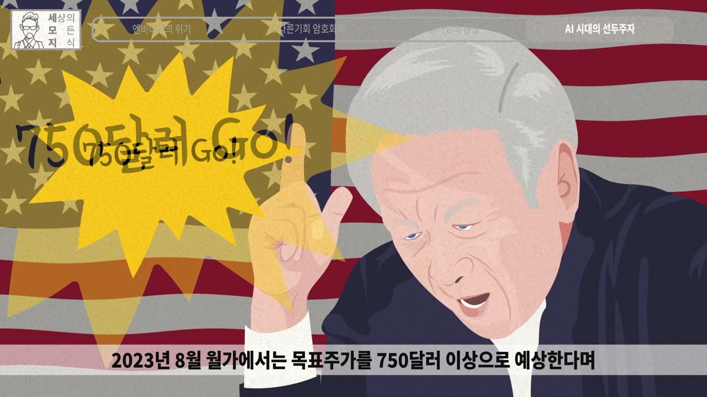 | `nv3_750_go_flag` | B146 엔비디아 3편 650초 | 텍스트 폭발 | 성조기 앞 노인의 흥분(750달러 Go!) | 월가 전망·주가 열풍 | 흥분 | 2023년 8월 월가에서는 목표주가를 750달러 이상으로 예상한다며 |
| 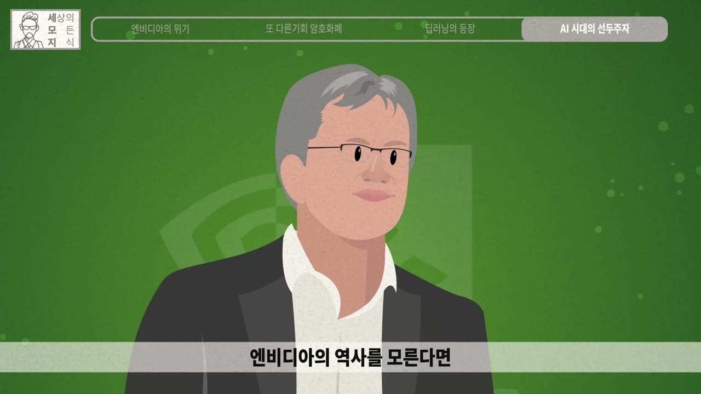 | `nv3_jensen_semireal` | B146 엔비디아 3편 660초 | 실사 캐리커처 반응 | 반실사 젠슨 황(흰 셔츠·검은 재킷) | 결론·인물 강조 | 진지 | 엔비디아의 역사를 모른다면 |
